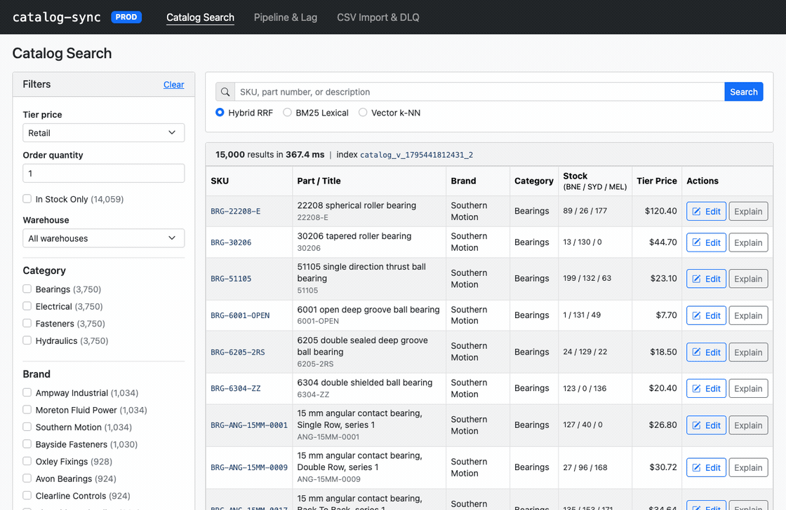
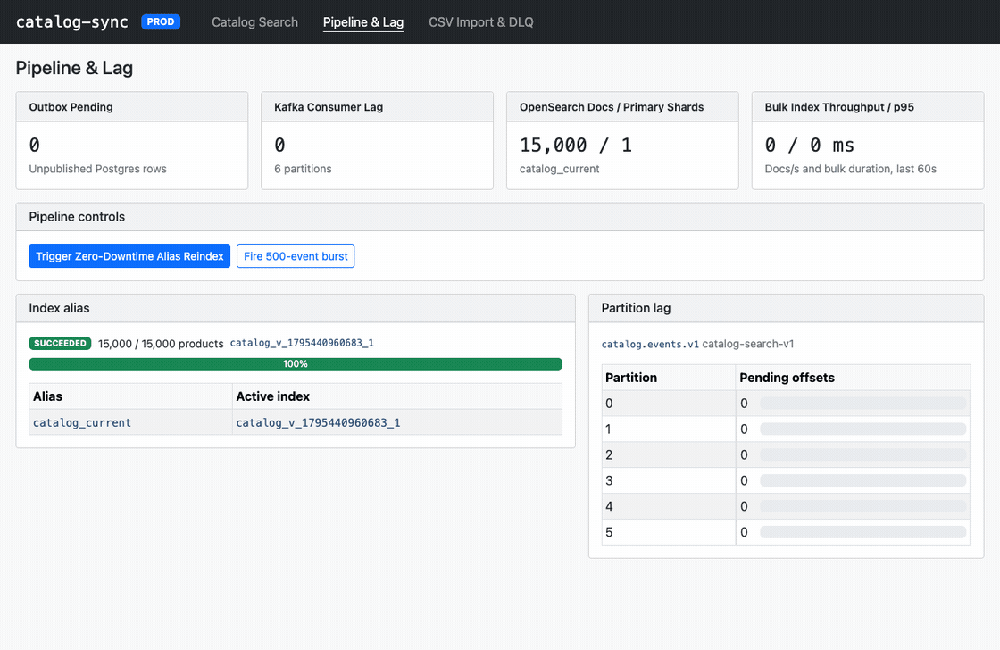

# catalog-sync

Postgres -> Kafka -> OpenSearch catalog and inventory sync pipeline with a
Bootstrap search and ops console. Stock and customer-tier prices are committed
with an outbox event. Search reads from the `catalog_current` alias.





## Local dev

Node 22, npm, and Docker Compose v2.

```sh
cp .env.example .env
docker compose up -d --wait
npm install
npm run db:migrate && npm run seed
npm run dev
```

Web on `http://127.0.0.1:5173`, API on `:4000`, OpenSearch on `:9200`.
The worker creates the topics and initial alias. Wait for the outbox and Kafka
lag to drain. The seed has 15,000 SKUs and three warehouses. Use
`npm run seed -- --count=100` for a smaller run.

For a Linux max_map_count startup error, set
`sudo sysctl -w vm.max_map_count=262144`. If OpenSearch exits with 137,
check Docker memory and allow room above its 512 MB Java heap.

## Search

Try `HXNSS316M12`, `hxn-ss316`, or `m12 metric stainless hex nut`.
Tier pricing uses the highest minimum quantity that the order qualifies for.
Availability is on-hand stock less reserved stock. Warehouse and in-stock
filters apply to the same inventory rows.

Hybrid search fuses up to 200 lexical and 200 vector candidates. Exact
normalized part numbers get priority. Open the Explain dialog to see the
ranks, scores, and indexed document. Lexical pages use the 10,000-row
OpenSearch result window. Apply a facet to narrow a larger result set.

One run of the 40-query benchmark against the 15,000-SKU seed:

| Mode | MRR@10 | Recall@10 |
| --- | ---: | ---: |
| Lexical | 0.650 | 0.650 |
| Semantic | 0.508 | 0.550 |
| Hybrid | 0.875 | 0.875 |

## Supplier CSV

Upload in the console or use the multipart endpoint.

```csv
sku,warehouse_code,on_hand,reserved,base_price_cents
FAST-HXN-SS316-M12,BNE-01,180,10,102
```

```sh
curl -F file=@supplier.csv http://127.0.0.1:4000/api/imports/csv
npm run simulate:load -- --once --count=500
npm run eval:search
npm test
```

New products should include `title`, `brand`, and `category`. A tier offer
uses `tier_code,min_qty,unit_price_cents`. Repeated SKU rows can update
multiple warehouses and price breaks in one import. The response counts input
rows and queued product events separately.

## Production

```sh
docker compose -f docker-compose.prod.yml up -d --build
docker compose -f docker-compose.prod.yml exec -T api npm run seed
curl -X POST http://127.0.0.1:8080/api/admin/reindex
```

The migrate service runs the numbered SQL before the API and worker start.
Seed is for a demo database. On an existing database, start a reindex after
migration to load the snapshot. The web port defaults to `8080`.

Use `DATABASE_URL`, `KAFKA_BROKERS`, and `OPENSEARCH_NODE` for standalone
processes. Compose accepts the same names prefixed with `PROD_` for external
services. If you change the bundled `POSTGRES_PASSWORD`, set the matching
database URL with the password URL-encoded. Set `KAFKA_TLS=true` and `KAFKA_SASL_USERNAME` /
`KAFKA_SASL_PASSWORD` for authenticated Kafka. Choose `plain`,
`scram-sha-256`, or `scram-sha-512` via `KAFKA_SASL_MECHANISM`.
`OPENSEARCH_USERNAME` and `OPENSEARCH_PASSWORD` enable basic authentication.

The bundled services listen on a private Docker network. Put the console
behind authenticated ingress for shared use. With `API_ADMIN_TOKEN` set,
send `Authorization: Bearer <token>` on writes and DLQ requests. The console
needs the authenticated proxy to supply that header.

Six Kafka partitions allow six indexing consumers in one group. Scale
`worker` with Compose. The relay uses row locks to share work and preserve
ordering for each product. Change topic partition counts deliberately.

The local MiniLM model is downloaded once and cached. The Alpine service image
runs its WebAssembly backend. Set `EMBEDDING_PROVIDER=openai` and
`OPENAI_API_KEY` to use OpenAI embeddings. Reindex with the new provider before
reopening vector queries so the query and index use the same embedding space.

## Notes

[Architecture and failure handling](docs/architecture.md)
