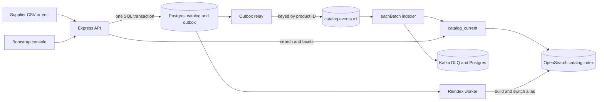
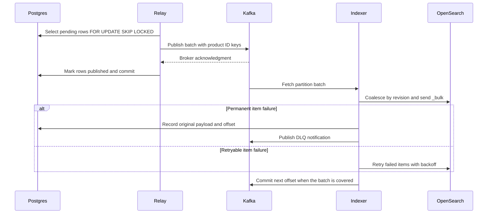

# architecture

## write path

A catalog mutation locks its product row before assigning a sequence number.
The stock, tier prices, product revision, and outbox snapshot commit together.
A separate Kafka write in the request could leave either system ahead of the
other after a crash.

## delivery and replay

The relay skips locked rows and checks for an earlier unpublished event per
product. A crash after Kafka acknowledges can still cause a duplicate. The
indexer keeps the newest event per product and uses its revision as an external
version. A version conflict covers a duplicate or stale replay. Indexed
tombstones keep old updates from reviving deleted products.

Bulk HTTP success can include failed items. Transient errors leave the offset
uncommitted until recovered. Permanent mapping or payload errors go to the DLQ.
Replay preserves the original revision. The consumer heartbeats during long
batches and leaves the group on SIGTERM. Defaults are a 30s session timeout and
a 3s heartbeat interval.

## alias rotation

The reindex worker sets up a timestamped target, then reads products by ID in
1,000-row chunks. While that job runs, the consumer writes both the current
alias and the target. External versions settle overlap between snapshot rows
and new updates. An exclusive Postgres advisory lock pauses target selection
while the worker refreshes the new index and sends one `_aliases` request.
The old index remains available for in-flight reads and manual cleanup.

## ranking

Normalize separators for exact part matches and edge n-grams. Explicit part
matches take priority. Reciprocal rank fusion uses `1 / (60 + rank)` per list,
which avoids mixing OpenSearch BM25 and k-NN score scales. Compare modes with
the 40-query benchmark. A cached query skips repeat model inference.
